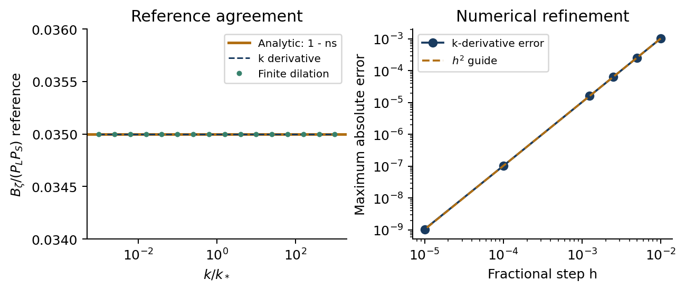
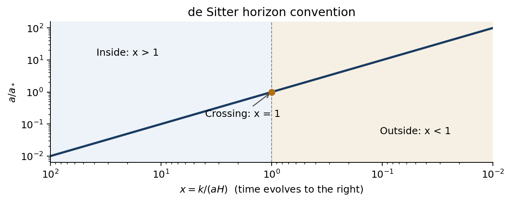

# Step 1: Spacetime, fields and observables

This step fixes the de Sitter horizon convention and checks the single-field squeezed-limit reference. For the specified spectral index `ns = 0.965`, the expected normalised bispectrum is `1 - ns = 0.035`. This is the reference for the later two-field calculation.

## Results



**Left:** direct differentiation of the power spectrum and differentiation of a finite spatial dilation both reproduce `0.035` across six decades of wavenumber. Their curves overlap the analytic reference. **Right:** the error decreases approximately as the square of the numerical step, confirming the expected central-difference convergence. The smallest-step error is about `1.05e-9`.



As the universe expands, `x = k/(aH)` decreases. The mode moves from inside the horizon (`x > 1`), crosses at `x = 1`, and reaches the outside region (`x < 1`). The line shows `a/a* = 1/x`; it checks the background convention rather than simulating a field mode.

All **10 validation checks pass**, including the zero reference at `ns = 1` and independence from the arbitrary power-spectrum normalisation.

| Saved file | What it shows |
| --- | --- |
| [Reference values](results/squeezed_reference.csv) | The analytic value and both numerical estimates at 121 wavenumbers; these are the data in the first plot's left panel. |
| [Convergence table](results/derivative_convergence.csv) | The maximum error at each differentiation step; these are the data in the right panel. |
| [Validation summary](results/summary.json) | Check results, maximum errors, tolerance, software versions and hashes identifying the tested code and inputs. |

## Reproduce

From the repository root, with Python 3.12:

```bash
python3 -m pip install -r step1/requirements.txt
python3 step1/step1.py --config step1/config.json
```

The [script](step1.py) regenerates the tables and figures using the [saved inputs](config.json). PNG previews are included here; vector PDFs are generated locally for report preparation.

Report source and compilation instructions: [latex/](latex/).

Download the [Step 1 PDF report](Step_01_Report.pdf).
