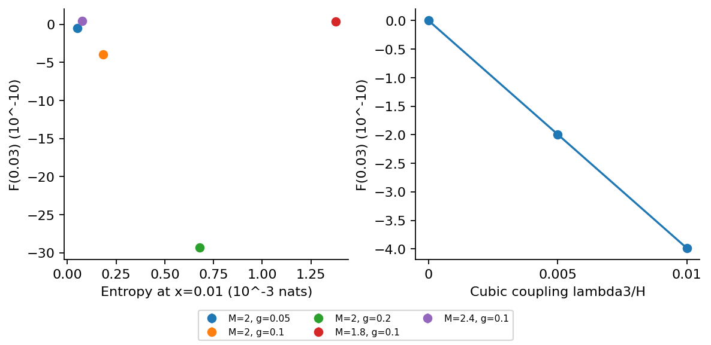

# Step 10: Entropy and the spectator signal

At fixed quadratic parameters, changing the cubic coupling leaves Gaussian entropy fixed while scaling the leading bispectrum. Entropy alone therefore cannot determine this signal amplitude.

[PDF report](Step_10_Report.pdf) · [LaTeX source](latex/) · [Calculation](step10.py)



Selected common-time entropy/signal comparisons and the independent cubic-coupling control. A single-triangle F also depends on phase. Selected-point error bars show regulator variation; the full baseline error budget is in Step 8.

| Saved result | Meaning |
| --- | --- |
| [entropy_signal_comparison.csv](results/entropy_signal_comparison.csv) | Selected mass/mixing points at x = 0.01 and r = 0.03. |
| [cubic_control.csv](results/cubic_control.csv) | The same Gaussian entropy with zero, half-strength and full-strength cubic signals. |
| [common_noise_control.csv](results/common_noise_control.csv) | An illustrative known-template signal/noise comparison under the same absolute mock covariance. |
| [summary.json](results/summary.json) | Key results, tested settings and software versions. |

Run from the repository root after installing `requirements.txt`:

```bash
python3 step10/step10.py
```

Run Steps 8 and 9 first; the fixed-covariance control uses the fitted baseline clock.
