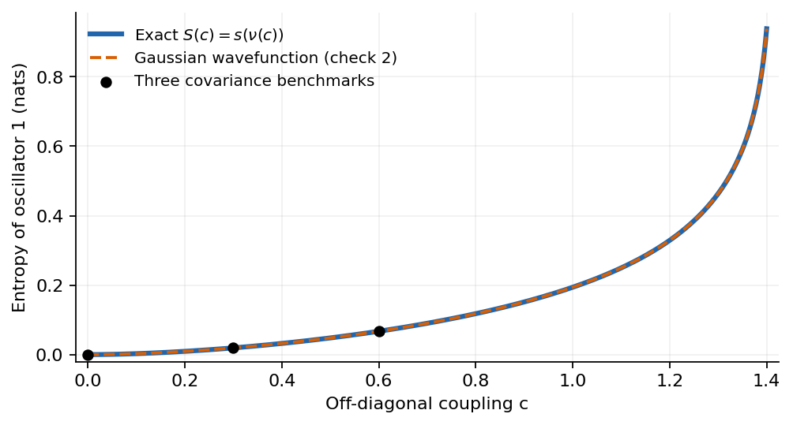

# Step 2: Two-oscillator Gaussian entropy

The benchmark gives nu = 0.5028165419863 and entropy = 0.0193599304236 nats. Local canonical rescaling leaves this entropy unchanged.

[PDF report](Step_02_Report.pdf) · [LaTeX source](latex/) · [Calculation](step2.py)



The solid blue curve evaluates the exact function S(c) = s(nu(c)) on 701 points from c = 0 to 1.4. The dashed orange curve independently obtains the von Neumann entropy from the reduced Gaussian wavefunction's geometric spectrum (check 2). The curves overlap to within 1e-12 nats. Black markers retain the original three covariance benchmarks.

Entropy is zero at c = 0 and increases with |c|. The stable domain is |c| < sqrt(2); the entropy diverges as the stability boundary is approached. Negative couplings give the same curve by symmetry. The Gaussian calculation uses the von Neumann entropy, rather than substituting the Rényi-2 entropy -log(purity).

| Saved result | Meaning |
| --- | --- |
| [oscillators.csv](results/oscillators.csv) | Coupling and rescaling checks, reduced eigenvalue, one-sector entropy and full-pair entropy. |
| [entropy_curve.csv](results/entropy_curve.csv) | All 701 plotted couplings, exact and covariance entropies, Gaussian purity and entropy, and Gaussian-minus-exact residual. |
| [summary.json](results/summary.json) | Key results, tested settings and software versions. |

Run from the repository root after installing `requirements.txt`:

```bash
python3 step2/step2.py
```

The scripts share the numerical routines in `common/`.
