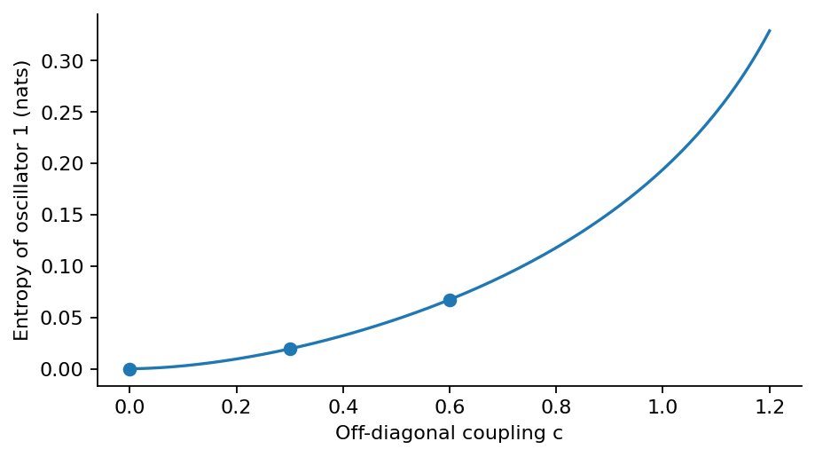

# Step 2: Two-oscillator Gaussian entropy

The benchmark gives nu = 0.5028165419863 and entropy = 0.0193599304236 nats. Local canonical rescaling leaves this entropy unchanged.

[PDF report](Step_02_Report.pdf) · [LaTeX source](latex/) · [Calculation](step2.py)



Entropy grows as the oscillators are coupled; the zero-coupling point has zero entropy.

| Saved result | Meaning |
| --- | --- |
| [oscillators.csv](results/oscillators.csv) | Coupling and rescaling checks, reduced eigenvalue, one-sector entropy and full-pair entropy. |
| [summary.json](results/summary.json) | Key results, tested settings and software versions. |

Run from the repository root after installing `requirements.txt`:

```bash
python3 step2/step2.py
```

The scripts share the numerical routines in `common/`.
