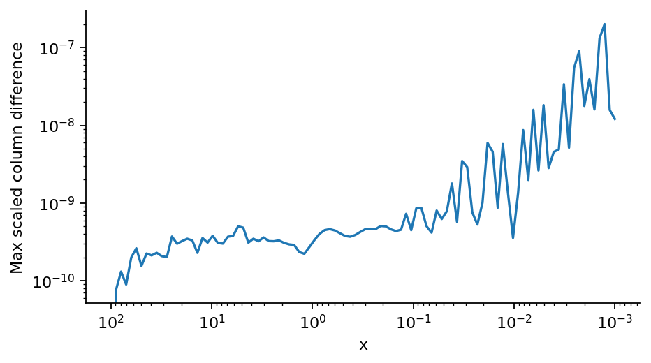

# Step 3: Canonical equations

A symbolic Legendre transform checks the Hamiltonian. Independently implemented canonical and velocity equations are compared on the same initial data.

[PDF report](Step_03_Report.pdf) · [LaTeX source](latex/) · [Calculation](step3.py)



The scaled complex-mode difference between the two formulations stays small over the integration interval.

| Saved result | Meaning |
| --- | --- |
| [hamilton_equations.txt](results/hamilton_equations.txt) | Expanded Hamiltonian and its four symbolic equations. |
| [formulation_agreement.csv](results/formulation_agreement.csv) | Power and entropy calculated by both formulations at the four comparison times. |
| [summary.json](results/summary.json) | Key results, tested settings and software versions. |

Run from the repository root after installing `requirements.txt`:

```bash
python3 step3/step3.py
```

The scripts share the numerical routines in `common/`.
