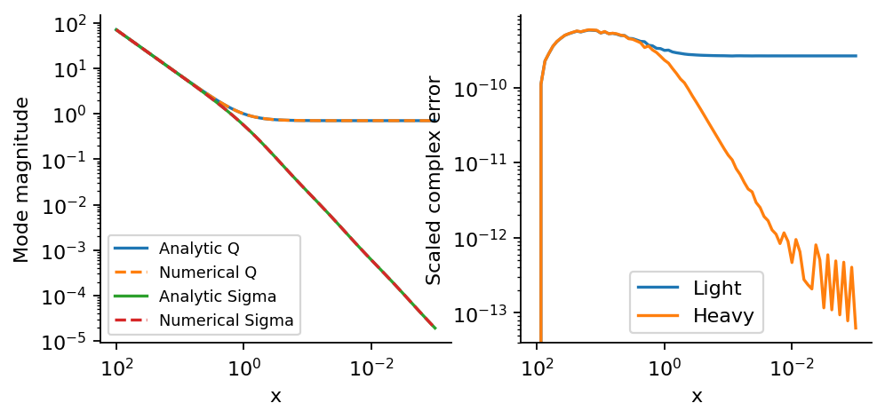
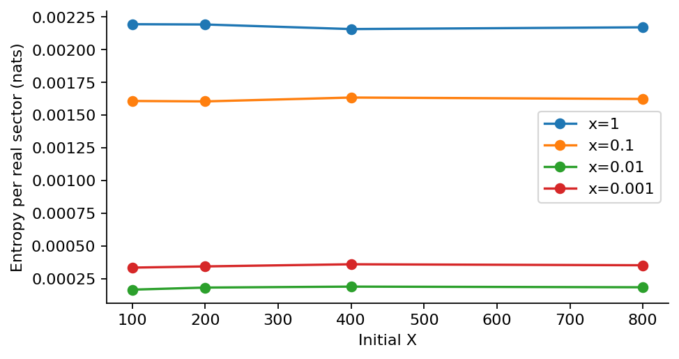

# Step 4: Free modes and initial states

Analytic Bunch-Davies modes validate the evolution. Finite starting-time product data are compared with higher-order ultraviolet initial data.

[PDF report](Step_04_Report.pdf) · [LaTeX source](latex/) · [Calculation](step4.py)



Both the light and heavy numerical modes match the analytic functions; the right panel shows complex-mode errors.



The finite-time product-state entropy changes with the initial X. Late samples failing the commutator test are diagnostic only.

| Saved result | Meaning |
| --- | --- |
| [free_mode_errors.csv](results/free_mode_errors.csv) | Complex-mode errors and canonical commutator residuals. |
| [initial_time_checks.csv](results/initial_time_checks.csv) | Product-state starting-time and tolerance checks. |
| [adiabatic_initial_state.csv](results/adiabatic_initial_state.csv) | Orders 4 and 6 compared at X = 100, 200, 400 and 800. |
| [free_complex_modes.npz](results/free_complex_modes.npz) | Saved complex free columns, including canonical momenta, for phase-sensitive checks. |
| [summary.json](results/summary.json) | Key results, tested settings and software versions. |

Run from the repository root after installing `requirements.txt`:

```bash
python3 step4/step4.py
```

The scripts share the numerical routines in `common/`.
