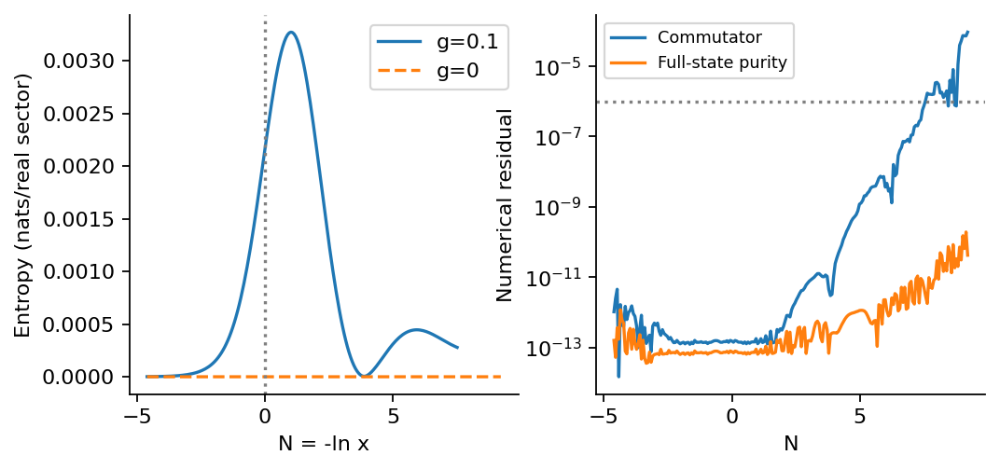
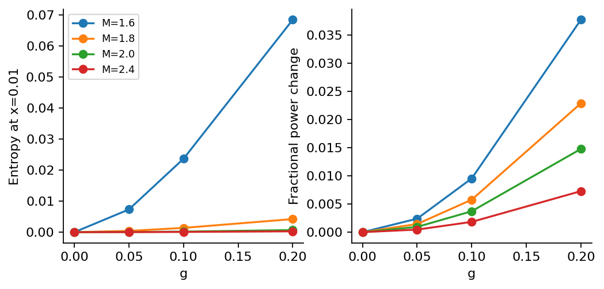

# Step 5: Gaussian entanglement

The mass/mixing scan passes all 64 requested comparisons. Entropy is reported in nats per real sector; the whole nonzero momentum pair contributes twice this value.

[PDF report](Step_05_Report.pdf) · [LaTeX source](latex/) · [Calculation](step5.py)



The benchmark entropy is shown only through the contiguous reliable interval. The adjacent diagnostics show where precision becomes inadequate.



Entropy and fractional power change are compared at the same time x = 0.01; they are different observables.

| Saved result | Meaning |
| --- | --- |
| [gaussian_scan.csv](results/gaussian_scan.csv) | Mass, mixing, common time, entropy, power change and reliability diagnostics. |
| [entropy_history.csv](results/entropy_history.csv) | The full sampled benchmark history, with residuals so rejected times remain identifiable. |
| [benchmark_complex_modes.npz](results/benchmark_complex_modes.npz) | Complex benchmark columns and numerical settings; retains phase information. |
| [summary.json](results/summary.json) | Key results, tested settings and software versions. |

Run from the repository root after installing `requirements.txt`:

```bash
python3 step5/step5.py
```

The scripts share the numerical routines in `common/`.
