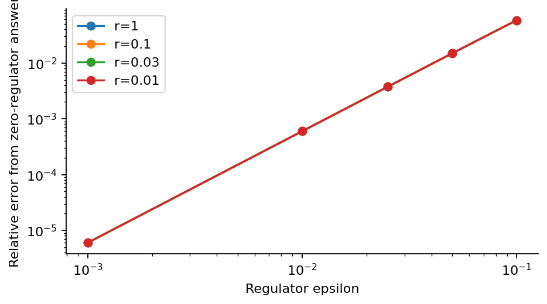

# Step 6: Heavy clock and in-in benchmark

The late-time clock frequency is sqrt(M^2 + g^2 - 9/4). An independent oscillatory integral reproduces the analytic test bispectrum.

[PDF report](Step_06_Report.pdf) · [LaTeX source](latex/) · [Calculation](step6.py)



Regulator errors decrease toward zero for equilateral and squeezed triangles. The dimensionless relative correction is common to all four curves.

| Saved result | Meaning |
| --- | --- |
| [in_in_benchmark.csv](results/in_in_benchmark.csv) | Analytic and numerical test values, relative errors and quadrature estimates. |
| [summary.json](results/summary.json) | Key results, tested settings and software versions. |

Run from the repository root after installing `requirements.txt`:

```bash
python3 step6/step6.py
```

The scripts share the numerical routines in `common/`.
