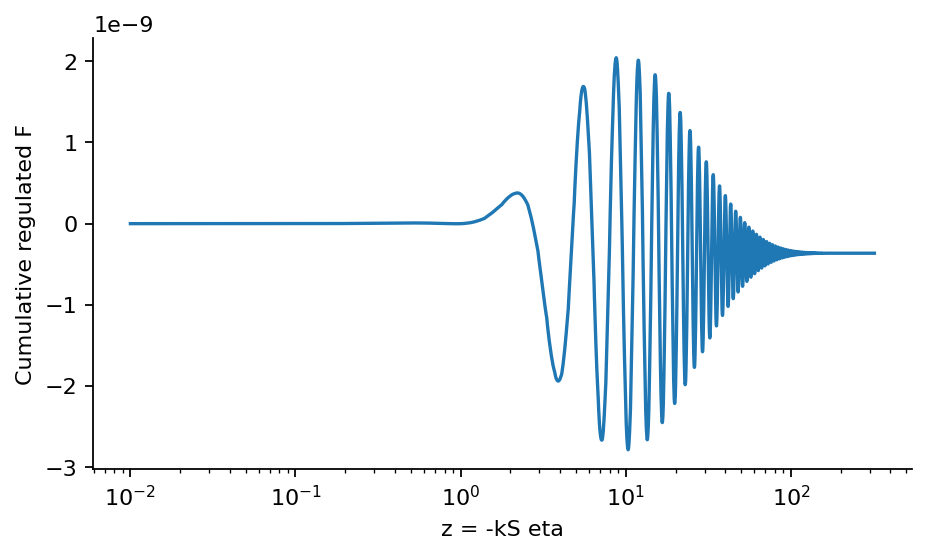

# Step 7: Spectator bispectrum

The leading sigma-cubed interaction is evaluated from complex mixed contractions at a common physical final time. Step 8 controls its regulator and initial-state errors.

[PDF report](Step_07_Report.pdf) · [LaTeX source](latex/) · [Calculation](step7.py)



The cumulative regulated integral reveals time-dependent cancellation and whether the early-time contribution has settled.

| Saved result | Meaning |
| --- | --- |
| [regulated_bispectrum.csv](results/regulated_bispectrum.csv) | Three pilot triangles before regulator removal. |
| [mixing_controls.csv](results/mixing_controls.csv) | Zero-mixing check and weak-mixing F/g^3 comparison. |
| [complex_integrand.npz](results/complex_integrand.npz) | Complex integrand, quadrature nodes/weights, final powers and settings. |
| [complex_modes.npz](results/complex_modes.npz) | Oscillation-resolving complex mode columns with canonical momenta. |
| [summary.json](results/summary.json) | Key results, tested settings and software versions. |

Run from the repository root after installing `requirements.txt`:

```bash
python3 step7/step7.py
```

The scripts share the numerical routines in `common/`.
