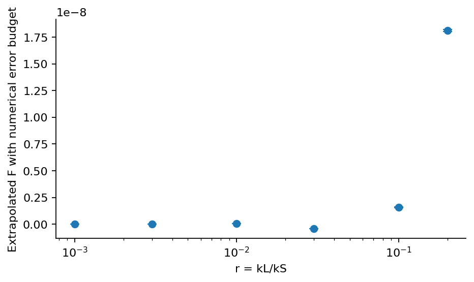

# Step 8: Convergence and numerical errors

Initial state, cutoff, regulator, ODE accuracy, quadrature and final-time effects are tested separately. The combined budget is a systematic numerical estimate.

[PDF report](Step_08_Report.pdf) · [LaTeX source](latex/) · [Calculation](step8.py)



Six pilot triangles with the sum of tested numerical changes. A near-zero value can have a large relative error even when the clock envelope is resolved.

| Saved result | Meaning |
| --- | --- |
| [error_budget.csv](results/error_budget.csv) | Extrapolated F and the six separately tested contributions to its numerical error. |
| [cutoff_and_regulator.csv](results/cutoff_and_regulator.csv) | Fixed-regulator tail tests and the regulated values used in extrapolation. |
| [initial_state_control.csv](results/initial_state_control.csv) | Why the finite-time product state is inadequate, and the stability of the higher-order initial state. |
| [adaptive_quadrature.csv](results/adaptive_quadrature.csv) | Independent adaptive quadrature checked against the Gauss result. |
| [variation_integrals.csv](results/variation_integrals.csv) | Every regulated value before extrapolation: codes 0/1/2/3/4/5 denote baseline, initial X, ODE tolerance, quadrature and the two final-time variations. |
| [summary.json](results/summary.json) | Key results, tested settings and software versions. |

Run from the repository root after installing `requirements.txt`:

```bash
python3 step8/step8.py
```

The scripts share the numerical routines in `common/`.
