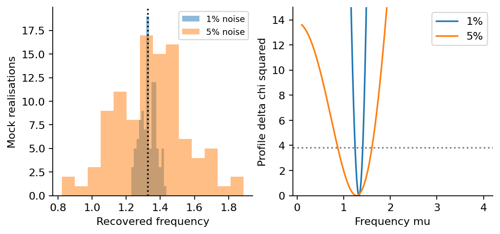
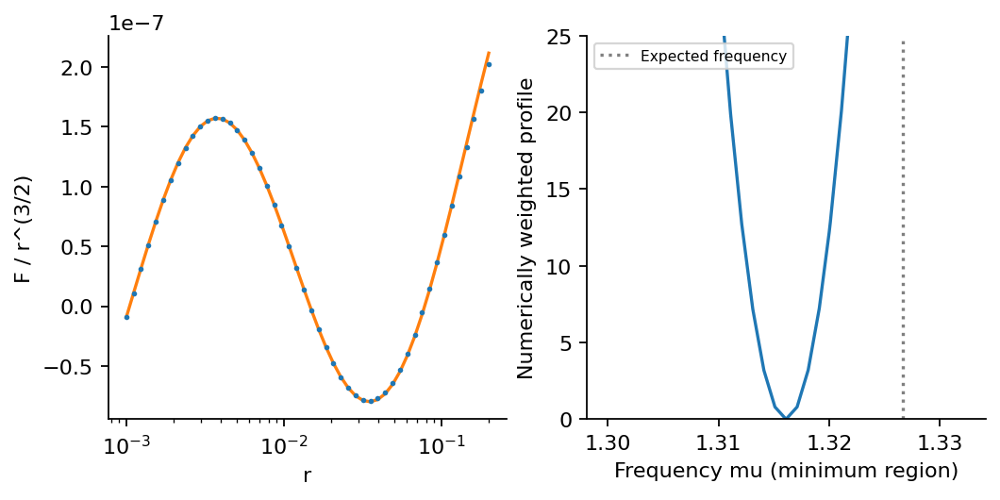

# Step 9: Mass recovery and fit stability

Mock data test the estimator with known noise. Physical data are fitted only after the convergence pilot passes, with background and momentum-window variations.

[PDF report](Step_09_Report.pdf) · [LaTeX source](latex/) · [Calculation](step9.py)



Mock frequency distributions and example profiles. The 95% intervals are tested on known Gaussian-noise mocks.



The physical clock shape is resolved, but its mass estimate is more sensitive to the fit model/window than a single narrow numerical profile suggests.

| Saved result | Meaning |
| --- | --- |
| [mock_recovery.csv](results/mock_recovery.csv) | All 200 mock frequency/mass estimates and interval-coverage indicators. |
| [mock_profile_1pct.csv](results/mock_profile_1pct.csv) | Example frequency profile at 1% mock noise. |
| [mock_profile_5pct.csv](results/mock_profile_5pct.csv) | Example profile at 5% mock noise. |
| [physical_bispectrum.csv](results/physical_bispectrum.csv) | The 50 physical triangles and conservative numerical errors. |
| [physical_regulated.csv](results/physical_regulated.csv) | All four regulated values for each of the 50 physical triangles. |
| [production_complex_modes.npz](results/production_complex_modes.npz) | Production complex columns, momenta and covariance reliability flags; late field contractions are checked separately when momenta lose precision. |
| [summary.json](results/summary.json) | Key results, tested settings and software versions. |

Run from the repository root after installing `requirements.txt`:

```bash
python3 step9/step9.py
```

Run Steps 8 and 9 in order; the physical-fit gate reads the Step 8 error budget.
